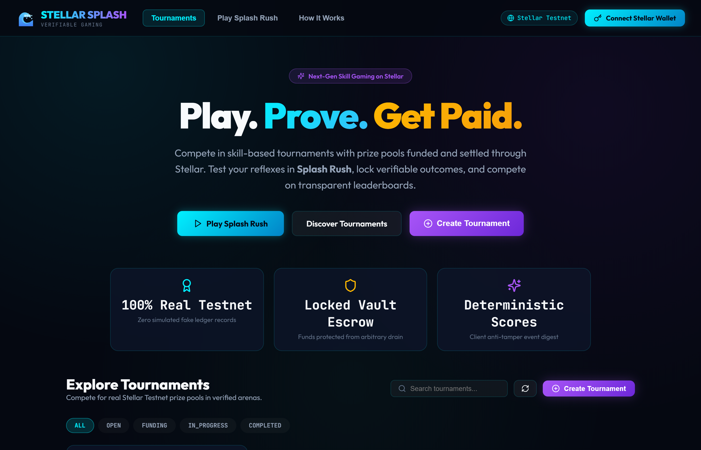
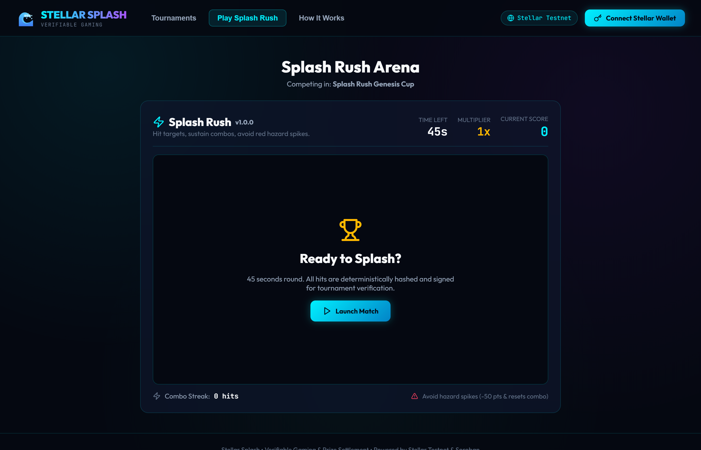
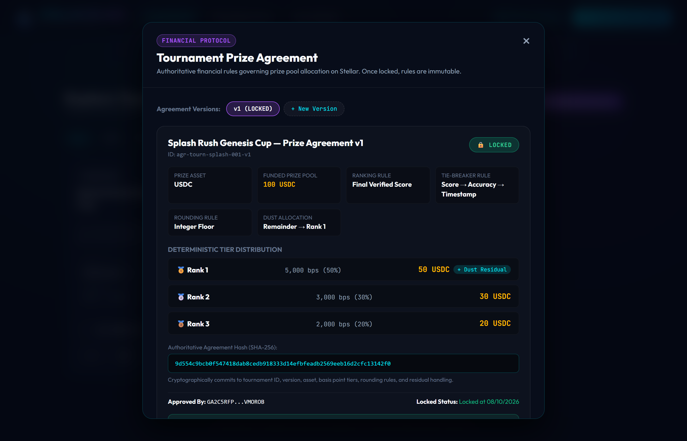
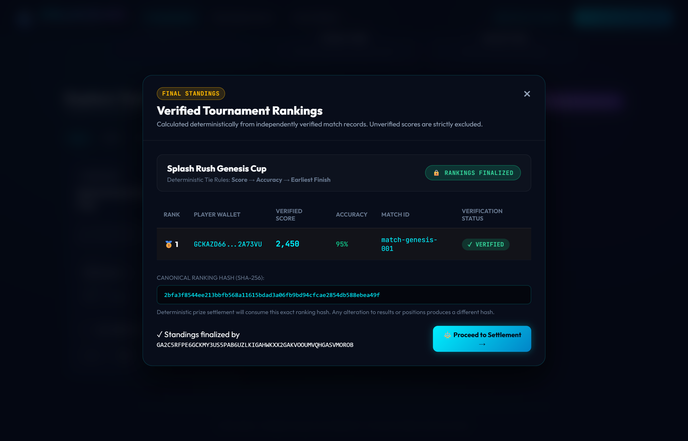
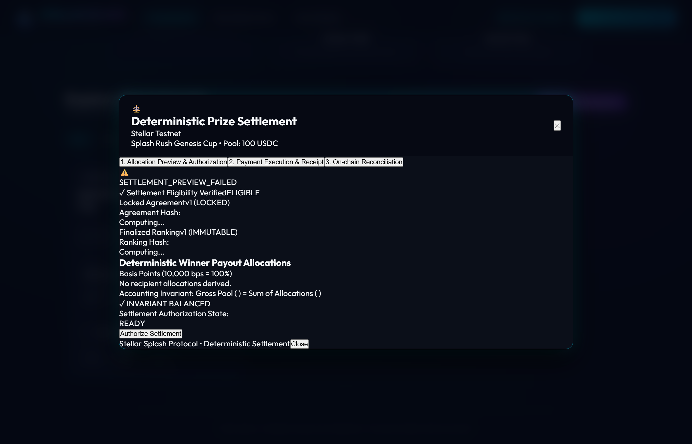
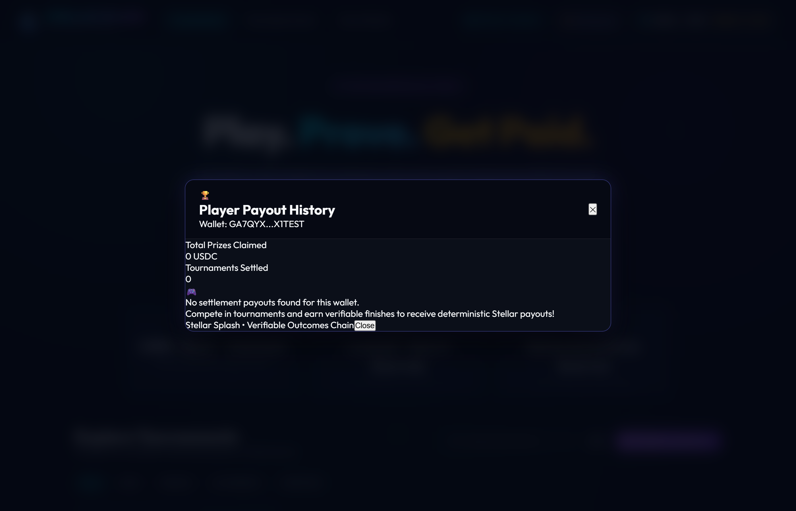

# 🌊 Stellar Splash Frontend

> **Play. Prove. Get Paid.**
>
> Compete in skill-based tournaments with prize pools funded, verified, and settled deterministically on Stellar.

[](https://app.netlify.com/projects/stellar-splash/deploys)
[](https://stellar.org)
[](https://lab.stellar.org/r/testnet/contract/CACHWJEZY6JN36VFACWRQ7FP4T5EPRRRNBVLOSFHXTJHETZY36JD7QYJ)

---

## 🚀 Live Deployments & Verified On-Chain Contract

| Resource / Transaction | Details / Stellar Explorer Link |
| :--- | :--- |
| **Live Web Application (Netlify)** | [https://stellar-splash.netlify.app](https://stellar-splash.netlify.app) |
| **Soroban Smart Contract ID** | [`CACHWJEZY6JN36VFACWRQ7FP4T5EPRRRNBVLOSFHXTJHETZY36JD7QYJ`](https://stellar.expert/explorer/testnet/contract/CACHWJEZY6JN36VFACWRQ7FP4T5EPRRRNBVLOSFHXTJHETZY36JD7QYJ) |
| **Stellar Expert Contract Explorer** | [View Contract on Stellar Expert](https://stellar.expert/explorer/testnet/contract/CACHWJEZY6JN36VFACWRQ7FP4T5EPRRRNBVLOSFHXTJHETZY36JD7QYJ) |
| **Stellar Lab Contract Explorer** | [View Contract in Stellar Lab](https://lab.stellar.org/r/testnet/contract/CACHWJEZY6JN36VFACWRQ7FP4T5EPRRRNBVLOSFHXTJHETZY36JD7QYJ) |
| **Contract Deploy Transaction** | [`36e93d93...6fb0` (Stellar Expert Tx)](https://stellar.expert/explorer/testnet/tx/36e93d93596fc018f13d15eb4363172b38af2d221b2d84252592ab3d25d76fb0) |
| **WASM Upload Transaction** | [`268685ea...fbe0` (Stellar Expert Tx)](https://stellar.expert/explorer/testnet/tx/268685ea94295e999a1d99c7aa5eeb833e3ef532cf6f5e0cc3eb2a6788a6fbe0) |
| **Admin Initialization Transaction** | [`27b3773d...1a11` (Stellar Expert Tx)](https://stellar.expert/explorer/testnet/tx/27b3773d0fc238d06e6ea8cfe9fc634a4ccc38e5939fa881ab7d894b918c1a11) |
| **Live Tournament Test Tx** | [`022786a7...2d7` (Stellar Expert Tx)](https://stellar.expert/explorer/testnet/tx/022786a7fc0a80ee5374932a8740b9209abc6dfaf30b54875af0122cbf3212d7) |
| **Contract Admin Address** | [`GCQ3OLBMJUGWN3PHYE3SDIKKIPVLJSFFWG4Q4CEABGHWGBEBPBKMY6OW`](https://stellar.expert/explorer/testnet/account/GCQ3OLBMJUGWN3PHYE3SDIKKIPVLJSFFWG4Q4CEABGHWGBEBPBKMY6OW) |
| **WASM Code Hash** | `f4c5ffc8ce6364eccb4c2a3daac045c508ba4f2d16b3a345d3c5f208057fb2d5` |
| **Network** | `Stellar Testnet` (Passphrase: `Test SDF Network ; September 2015`) |
| **Horizon RPC** | `https://horizon-testnet.stellar.org` |
| **Soroban RPC** | `https://soroban-testnet.stellar.org` |

---

## 📸 Product Operations & Screenshots

### 1. Tournament Discovery & Prize Pool Escrow
Explore open tournaments, real-time participant counters, entry fees, and prize pool funding status backed by Stellar Testnet escrow vaults.



*Key Operations:*
- Live status filters (`OPEN`, `FUNDING`, `IN_PROGRESS`, `COMPLETED`).
- Immediate Friendbot testnet wallet funding for zero-friction player onboarding.
- Real-time prize pool escrow balances tracked directly against Stellar ledger states.

---

### 2. Splash Rush Gameplay Arena
High-speed 45-second browser skill game featuring dynamic targets, combo multipliers, hazard avoidance, and client-side deterministic event streaming.



*Key Operations:*
- Canvas particle loop with 60 FPS precision and reactive visual feedback.
- High-frequency event recording capturing timestamped click events, target variants, and positions.
- Immediate payload serialization preventing score fabrication before ingestion by the backend verification engine.

---

### 3. Prize Agreement & Basis-Point Financial Governance
Transparent, immutable prize agreements establishing the mathematical terms of settlement before gameplay commences.



*Key Operations:*
- Basis-point allocation breakdown strictly adhering to the 10,000 bps invariant ($100.00\%$).
- Exact integer floor rounding and deterministic dust allocation assigned to Rank 1.
- Multi-party creator approval workflow and permanent cryptographic locking (`LOCKED`).

---

### 4. Verified Tournament Standings & Canonical Ranking Hash
Deterministic standings calculated exclusively from independently verified match replay scores, locked under a 32-byte SHA-256 ranking hash.



*Key Operations:*
- 3-tier tie-breaking algorithm: Primary (Score), Secondary (Accuracy), Tertiary (Completion Timestamp).
- Explicit audit verification for each player match with signed verifier attestations.
- Canonical ranking hash registration committed on-chain to prevent ranking tampering.

---

### 5. Deterministic Prize Settlement & Multi-Recipient Payouts
Cryptographically authorized, multi-recipient settlement executed directly from the Stellar escrow vault.



*Key Operations:*
- 5-point automated settlement eligibility verification.
- Real-time accounting invariant checks ($100\%$ sum consistency).
- Multi-recipient Stellar Testnet transfers with individual transaction hashes and Stellar Expert explorer links.

---

### 6. Player Payout History & Settlement Receipts
Personal settlement dashboard providing players with transparent, cryptographically verifiable records of their tournament earnings.



*Key Operations:*
- Historical payout receipts with timestamp, rank, prize asset, and amount.
- Direct links to Stellar Expert Explorer for immutable on-chain payment proof.
- Continuous on-chain reconciliation verification (`RECONCILED`).

---

## 🛠️ Architecture & Data Flow

```text
               +-------------------------------------------+
               |          Stellar Splash Frontend          |
               +-------------------------------------------+
                                     |
         +---------------------------+---------------------------+
         |                                                       |
         v                                                       v
+------------------+                                    +------------------+
|   Splash Rush    |                                    |  Wallet & Stellar|
|   Game Engine    |                                    |  Payment Gateway |
+------------------+                                    +------------------+
| - Canvas loop    |                                    | - Testnet wallet |
| - Particle synth |                                    | - Sign & Submit  |
| - Event stream   |                                    | - Vault deposit  |
+------------------+                                    +------------------+
         |                                                       |
         +---------------------------+---------------------------+
                                     |
                                     v
                        +--------------------------+
                        |  Splash Engine (REST)    |
                        |  & Live SSE Event Stream |
                        +--------------------------+
```

---

## 🎮 Game Rules: Splash Rush v1.0.0

- **Round Duration**: 45 seconds.
- **Scoring Formula**:
  $$\text{Score} = \text{Base Points} + \text{Combo Bonus} + \text{Multiplier Bonus} - \text{Penalties}$$
- **Target Types**:
  - **Standard Target (Cyan)**: 100 Base Points.
  - **Burst Target (Purple)**: 200 Base Points.
  - **Golden Target (Gold)**: 300 Base Points.
  - **Hazard Spike (Red)**: -50 Penalty points and resets combo streak to 0.
- **Multipliers**:
  - 5 Combo Streak: 2x
  - 10 Combo Streak: 3x
  - 15+ Combo Streak: 4x

---

## 💻 Local Development

### Prerequisites
- Node.js >= 18.x
- npm >= 9.x

### Installation
```bash
npm install
```

### Run Tests
```bash
npm test
```

### Start Development Server
```bash
npm run dev
```
The application will launch on `http://localhost:3000` and proxy backend requests to port `4000`.

### Production Build
```bash
npm run build
```
Deploy the resulting `dist/` directory to Netlify or any static hosting provider.
