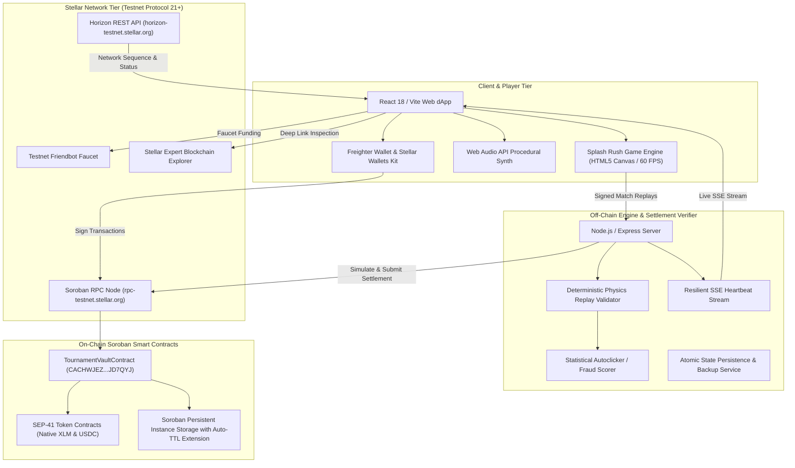

# 🌌 Stellar Splash: Ecosystem Integration & Architecture Map

---

## 1. High-Level Ecosystem Topology

---

## 2. Stellar & Soroban Technology Integrations

### 2.1 Soroban Smart Contracts (Protocol 21)
- **Contract Address**: `CACHWJEZY6JN36VFACWRQ7FP4T5EPRRRNBVLOSFHXTJHETZY36JD7QYJ`
- **Native Soroban Features Utilized**:
  - `env.storage().persistent()` and `env.storage().instance()` for contract state
  - `extend_ttl(17280, 518400)` preventing state archival
  - `env.events().publish(...)` emitting indexed telemetry
  - `env.deployer().update_current_contract_wasm(...)` for secure contract upgrades
  - Emergency circuit breaker `pause()` and `unpause()`

### 2.2 SEP-41 Token Standard & Stellar Asset Contracts (SAC)
- Both native XLM and custom fungible tokens (e.g. testnet USDC) are supported through the standardized Soroban Token interface (`token::Client`).
- Supports both direct `transfer` and delegated `transfer_from` allowance workflows.

### 2.3 Non-Custodial Wallets
- Native `@stellar/freighter-api` integration for signing contract invocations.
- Fallback integration through `@creit.tech/stellar-wallets-kit` supporting Freighter, xBull, Hana, Lobstr, and WalletConnect.
- Zero private keys in local storage.

### 2.4 Blockchain Explorer Deep Linking
- Every transaction hash, contract address, and account public key has dynamic, copy-to-clipboard links pointing directly to [Stellar Expert](https://stellar.expert/explorer/testnet).

### 2.5 Horizon & Soroban RPC Telemetry
- Client queries Stellar Horizon for ledger sequence numbers, average fee statistics, and protocol versions.
- Soroban RPC handles transaction simulation, footprint preflight, and consensus status verification.
